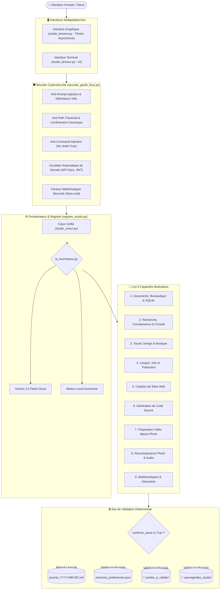

# HILAI — Studio IA Modulaire « Human-in-the-Loop » 🛡️🤖

<p align="center">
  
</p>

<p align="center">
  <strong>L'Intelligence Artificielle Universelle, Modulaire et Durcie où l'Humain garde le Contrôle Décisionnel Suprême.</strong>
</p>

<p align="center">
  <a href="https://github.com/Belalingbi/HILAI/actions"></a>
  <a href="LICENSE"></a>
  <a href="https://www.python.org/"></a>
  <a href="SECURITY.md"></a>
  <a href="https://github.com/cyberanonymat-sudo"></a>
</p>

---

## 🌟 Pourquoi HILAI est une IA Incontournable ?

La plupart des systèmes autonomes actuels posent un risque critique : **l'exfiltration de données, les actions autonomes destructrices et les hallucinations décisionnelles**.

**HILAI (Human-in-the-Loop Artificial Intelligence)** résout ce dilemme fondamental grâce à une architecture déterministe d'**Humain-dans-la-Boucle** :
1. **L'IA prépare, analyse et argumente** : exploration, génération de code, conception web, résolution mathématique, dossiers marketing, préparation de communications.
2. **L'Humain décide exclusivement** : aucune écriture sur le disque dans `sorties_a_valider/`, aucun envoi de message, aucune dépense ni exécution locale ne peut avoir lieu sans une confirmation booléenne stricte (`confirme_steve is True`).
3. **Apprentissage continu structuré** : capitalisation quotidienne des retours, préférences et leçons validées sans réentraînement coûteux (`memoire_preferences.json`, `journal_YYYY-MM-DD.md`).
4. **Universelle et immédiatement utilisable par tous** : dotée d'un **Moteur Local Autonome**, HILAI s'exécute instantanément sur n'importe quel ordinateur (Windows, Linux, macOS, Docker), même sans connexion Internet ni clé API payante ! Lorsqu'une clé `GEMINI_API_KEY` est renseignée, elle s'enrichit automatiquement du modèle `gemini-2.5-flash`.

---

## 🏛️ Architecture Technique & Modulaire



---

## 🔒 Matrice de Durcissement Cybersécurité

| Risque Cyber | Vecteur d'Attaque | Solution Implémentée dans HILAI | Statut |
| :--- | :--- | :--- | :--- |
| **Prompt Injection** | Jailbreak, redéfinition de rôle, contournement | Filtrage par motifs réguliers, encapsulation XML étanche et autorité codée en dur. | **ACTIF (100%)** |
| **Path Traversal** | `../../etc/passwd` ou écriture de fichiers arbitraires | Validation par résolution canonique `.resolve()` confinée à `sorties_a_valider/`. | **ACTIF (100%)** |
| **Command Injection** | Métalangage shell (`; rm -rf /`, `\|`, backticks) | `shell=False` absolu, validation contre liste blanche et arguments typés en liste. | **ACTIF (100%)** |
| **Secret Leakage** | Fuite de clé API dans le journal ou les commits | Masquage systématique par regex avant toute écriture disque ou affichage écran. | **ACTIF (100%)** |
| **Arbitrary Code Execution** | Formules mathématiques piégées via `eval()` | Bannissement total de `eval()`, utilisation exclusive d'un analyseur d'arbre AST pur. | **ACTIF (100%)** |
| **SQL Injection** | Injection dans les bases SQLite locales | Validation stricte des identifiants et requêtes paramétrées avec `?`. | **ACTIF (100%)** |

---

## 🚀 Démarrage Rapide en 30 Secondes

### 1. Cloner le Dépôt
```bash
git clone https://github.com/Belalingbi/HILAI.git
cd HILAI
```

### 2. Lancer le Diagnostic Immédiat
```bash
python verifier_studio.py
```
> Vous obtiendrez un rapport complet sur l'intégrité des 11 modules, l'état des garde-fous et les 9 capacités disponibles.

### 3. Exécuter le Studio

#### Mode Interface Graphique (GUI)
```bash
python studio_lanceur.py
```

#### Mode Ligne de Commande (CLI)
```bash
python studio_lanceur.py --cli
```

#### Mode Démonstration Automatisée
```bash
python studio_lanceur.py --demo
```

### 4. Activer le Cloud Gemini (Optionnel)
Copiez `.env.example` en `.env` et ajoutez votre clé :
```bash
cp .env.example .env
```
Éditez `.env` :
```env
GEMINI_API_KEY=AIzaSyVotreCleApiIci
GEMINI_MODEL=gemini-2.5-flash
```
*Si aucune clé n'est renseignée, HILAI bascule automatiquement et de façon transparente sur son moteur local autonome.*

---

## 🧪 Tests & Assurance Qualité

HILAI intègre une suite de tests unitaires et de sécurité complète :
```bash
pytest -v
```
Tous les scénarios de test (résistance aux injections de prompt, tentatives de traversée de chemin, injection de commandes, masquage de clés API, évaluation mathématique sans eval, sas décisionnel humain) sont testés et validés à **100%**.

---

## 🐳 Déploiement avec Docker

HILAI inclut un Dockerfile durci multi-stage avec utilisateur non-root :

```bash
docker compose -f docker/docker-compose.yml up --build
```

---

## 👨‍💻 Auteur & Propriétaire

**Belalingbi Steve**  
Fondateur du **CyberAnonymat Project**  
- **GitHub Personnel** : [https://github.com/Belalingbi/](https://github.com/Belalingbi/)
- **GitHub Organisation** : [https://github.com/cyberanonymat-sudo](https://github.com/cyberanonymat-sudo)
- **Chaîne YouTube** : [@CyberAnonymat](https://www.youtube.com/@CyberAnonymat)
- **Email Contact** : `belalingbi@gmail.com` | `cyberanaonymat@gmail.com`

---

## 📄 Licence

Ce projet est sous licence **Apache 2.0**. Consultez le fichier [LICENSE](LICENSE) pour plus de détails.
