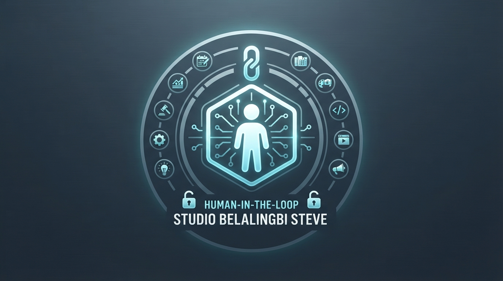
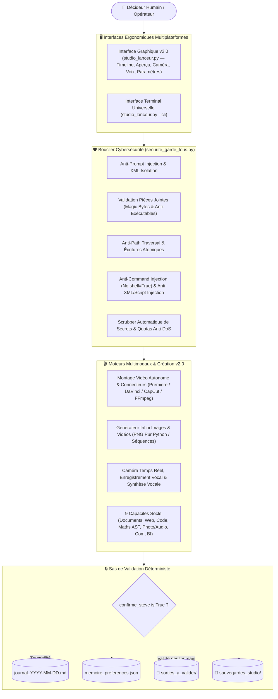

# HILAI v2.0 — Studio IA Universel, Multimodal & « Human-in-the-Loop » 🛡️🤖🎬

<p align="center">
  
</p>

<p align="center">
  <strong>L'Intelligence Artificielle Universelle, Multimodale, Créative et Cybersécurisée où l'Humain garde le Contrôle Décisionnel Suprême.</strong>
</p>

<p align="center">
  <a href="https://github.com/Belalingbi/HILAI/actions"></a>
  <a href="LICENSE"></a>
  <a href="https://www.python.org/"></a>
  <a href="SECURITY.md"></a>
  <a href="https://github.com/cyberanonymat-sudo"></a>
</p>

---

## 🌟 Pourquoi HILAI v2.0 est une IA Incontournable & Universelle ?

**HILAI (Human-in-the-Loop Artificial Intelligence)** combine la puissance d'un studio multimodal complet avec un **durcissement cybersécurité déterministe** et un **Moteur Local Autonome** qui fonctionne immédiatement sur Windows, Linux, macOS et Docker — **même sans connexion Internet ni clé API payante** !

### ✨ Nouveautés majeures de la v2.0
1. **🎬 Montage Vidéo Autonome sur Instructions Écrites (`montage_video_studio.py`)** : décrivez votre montage en français/anglais (durée, format `16:9` / `9:16` / `1:1`, style, transitions, sous-titres, musique), HILAI assemble automatiquement une timeline multi-pistes, génère les sous-titres `.srt`, et produit le rendu vidéo (via FFmpeg si installé, ou storyboard PNG + recette complète).
2. **🔌 Connecteurs Plateformes de Montage** : export direct et assaini vers **Adobe Premiere Pro** (`xmeml` XML + script ExtendScript `.jsx`), **DaVinci Resolve** (script Python API + `.edl` + `.fcpxml`), **CapCut / Web** (`draft_content.json`), **FFmpeg** et **Export Universel EDL/XML/SRT**.
3. **♾️ Génération Infinie d'Images & de Vidéos (`generateur_media_infini.py`)** : flux génératif continu avec styles configurables, aperçu en direct dans le studio, encodeur PNG/séquences universel 100% Python pur (sans dépendance lourde obligatoire) et protection anti-saturation disque.
4. **📷 Vision & Interaction Caméra Temps Réel (`multimodal_capteurs.py`)** : flux caméra en direct (`opencv-python` + fallback universel), détection de présence/visages/mouvement/luminosité, prise de décision contextuelle assistée et réponse vocale.
5. **🎙️ Enregistrement Vocal, Conversation & Pièces Jointes** : bouton d'enregistrement micro natif (`winmm` Windows / `sounddevice`), synthèse vocale IA, bouton pièce jointe rapide `📎` et import sécurisé d'images, vocaux, vidéos et documents (vérification des octets magiques et blocage d'exécutables).
6. **⚙️ Menu Paramètres & Personnalisation des Couleurs (`parametres_studio.py`)** : 5 thèmes ergonomiques (*CyberMidnight Dark*, *CyberAnonymat Matrix*, *Obsidian Studio Pro*, *Deep Indigo Cinema*, *Clair Ergonomique*) + sélecteur de couleurs personnalisées en direct, configuration IA/Voix/Caméra et quotas cybersécurité.
7. **🛡️ Souveraineté Human-in-the-Loop** : aucune écriture finale dans `sorties_a_valider/`, aucun export montage ni envoi externe sans `confirme_steve is True`.

---

## 🏛️ Architecture Technique & Modulaire



---

## 🔒 Matrice de Durcissement Cybersécurité

| Risque Cyber | Vecteur d'Attaque | Solution Implémentée dans HILAI v2.0 | Statut |
| :--- | :--- | :--- | :--- |
| **Prompt Injection & Breakout** | Jailbreak FR/EN, `</untrusted_input>`, contournement | Détection regex multi-langues, neutralisation XML et autorité booléenne stricte. | **ACTIF (100%)** |
| **Pièces Jointes Malveillantes** | Exécutables `.exe/.bat/.ps1` renommés en `.png`/`.mp4` | Liste noire d'exécutables, contrôle d'octets magiques, taille max et empreinte SHA-256. | **ACTIF (100%)** |
| **Path Traversal** | `../../etc/passwd` ou écriture arbitraire | Résolution canonique `.resolve()` confinée à `sorties_a_valider/` + écritures atomiques. | **ACTIF (100%)** |
| **Command & Script Injection** | Métalangage shell, XSS/XXE dans XML montage ou `.jsx`/`.py` | `shell=False` absolu, liste blanche FFmpeg/Python, échappement XML et encodage JSON des scripts. | **ACTIF (100%)** |
| **Secret Leakage** | Fuite de clé Gemini, OpenAI, GitHub, AWS, JWT, clé privée | Masquage systématique par regex avant logs/disque ; aucun secret dans `config_studio.json`. | **ACTIF (100%)** |
| **DoS Flux Infini / Eval** | Saturation disque/RAM ou `eval()` malveillant | `ControleurQuotaRessources` borné + parseur mathématique AST pur sans `eval()`. | **ACTIF (100%)** |

---

## 🚀 Démarrage Rapide pour Tous (Windows / Linux / macOS)

### 1. Cloner le Dépôt
```bash
git clone https://github.com/Belalingbi/HILAI.git
cd HILAI
```

### 2. Installation (Zéro Dépendance Requise pour Démarrer, ou Complète)
HILAI démarre immédiatement avec Python >= 3.10 standard :
```bash
python verifier_studio.py
python studio_lanceur.py
```
Pour activer toutes les options Cloud, Bureautique, Webcam & Audio étendues :
```bash
pip install -r requirements.txt
# Optionnel (webcam OpenCV, Pillow, voix pyttsx3, micro sounddevice) :
pip install opencv-python pillow pyttsx3 sounddevice
```

### 3. Modes d'Exécution
- **Interface Graphique Ergonomique v2.0 (GUI)** : `python studio_lanceur.py`
- **Interface Terminal Universelle (CLI)** : `python studio_lanceur.py --cli`
- **Diagnostic Sécurité & Modules** : `python studio_lanceur.py --diag`
- **Démonstration Automatisée Complète** : `python studio_lanceur.py --demo`

### 4. Activer l'IA Cloud Gemini (Optionnel)
```bash
cp .env.example .env
# Éditez .env ou utilisez le menu « ⚙️ Paramètres & Couleurs » dans l'interface graphique
```
*Sans clé API, HILAI bascule automatiquement sur son Moteur Local Autonome.*

---

## 🧪 Tests & Assurance Qualité

```bash
pytest -v
```

---

## 🐳 Déploiement avec Docker

```bash
docker compose -f docker/docker-compose.yml up --build
```

---

## 👨‍💻 Auteur & Propriétaire

**Belalingbi Steve**  
Fondateur du **CyberAnonymat Project**  
- **GitHub Personnel** : [https://github.com/Belalingbi/](https://github.com/Belalingbi/)
- **GitHub Organisation** : [https://github.com/cyberanonymat-sudo](https://github.com/cyberanonymat-sudo)
- **Chaîne YouTube** : [@CyberAnonymat](https://www.youtube.com/@CyberAnonymat)
- **Email Contact** : `belalingbi@gmail.com` | `cyberanaonymat@gmail.com` | `belalingbi@europe.com`

---

## 📄 Licence

Ce projet est sous licence **Apache 2.0**. Consultez le fichier [LICENSE](LICENSE) pour plus de détails.
